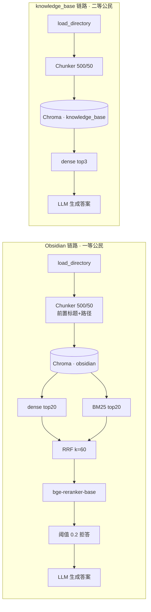

# RAG 企业级差距评估

> 项目：后端面经 RAG Agent（`E:\pythonprojects\growth-companion`）
> 评估日期：2026-11-22 ｜ 评估方式：**只读审计**（静态阅读代码 + 引用现有评测报告），未改动任何代码
> 结论摘要：检索算法已到个人项目的上限区间；企业级差距的约 70% 不在算法，而在**数据接入、索引治理、权限隔离、可观测运维**四层。

---

## 一、评估口径

「企业级」有两个口径，混着谈容易失焦，本文分开评估：

| 口径 | 关注点 | 代表产物 | 回答的问题 |
|---|---|---|---|
| 产品能力 | 能接什么数据、解析得多好、答案能不能溯源 | RAGFlow、Dify、Onyx | 这套系统**能不能用** |
| 工程要求 | 多租户、ACL、审计、SLA、不停机变更 | Onyx 企业版、云厂商 RAG 服务 | 这套系统**敢不敢给 500 个人用** |

本文的判定原则：只写能在代码里指到行号的结论；对标项目只写"该抄哪一块"，不写"它有多少 star"。

---

## 二、当前基线

### 2.1 两条链路并存（第一个架构事实）

项目里实际有两条 RAG 链路，能力并不对等：



| 能力 | Obsidian 链路 | knowledge_base 链路 |
|---|---|---|
| 召回方式 | dense + BM25 双路，各 20 条 | 仅 dense，top3 |
| 融合 | RRF（k=60） | 无 |
| 精排 | `bge-reranker-base` | 无 |
| 拒答 | 分数阈值 0.2 | 无（任何问题必返 3 条） |
| 增量索引 | mtime + 切片数一致性校验 | 无（全量重跑，且会重复入库） |
| 溯源信息 | chunk 前置文件名 + 路径 | 同左，但检索结果不返回给调用方 |

**结论**：论文级的检索设计只服务 Obsidian；用户上传的文档走的是最原始的一条路。同一个系统两套检索质量，在企业里叫"能力不可预期"。

### 2.2 当前参数

| 项 | 值 | 位置 |
|---|---|---|
| embedding | `BAAI/bge-small-zh-v1.5`，512 维，本地 CPU | `knowledge/config.py:48` |
| 切片 | `chunk_size=500`，`overlap=50`，按 `\n## ` 等分隔符递归 | `knowledge/chunker.py:23` |
| 召回池 | `RECALL_N=20` | `knowledge/config.py:30` |
| 送入生成 | `TOP_K=3` | `knowledge/config.py:27` |
| 精排 | `BAAI/bge-reranker-base`，max_length=512 | `knowledge/reranker.py:20` |
| 拒答阈值 | 0.2（基于 25 条样本校准） | `knowledge/config.py:38` |
| 向量库 | Chroma 嵌入式（SQLite 持久化） | `knowledge/vector_store.py:35` |
| 服务形态 | 单进程 uvicorn，`reload=True` | `api.py:1110` |

### 2.3 已有的质量证据（不是空口）

| 指标 | 数值 | 口径 / 来源 |
|---|---|---|
| dense 宽召回命中 | 14/21 = 66.7% | 20 条召回池内命中，**不是** top-3 |
| BM25 宽召回命中 | 15/21 = 71.4% | 同上 |
| 最终命中率（RRF + 精排） | 15/21 = 71.4% | 生产路径，精排后取 top-3 |
| Recall@3 | 15/21 = 71.4% | 同上 |
| not_in_kb 越界检出 | 0/4 | 精排阈值 0.2 拦截 |
| e2e 路由准确率 | 35/36 = 97.2% | `eval/reports/e2e-report.md`（2026-11-11） |
| 并发压测 | 1u 6.3s → 5u 24s → 10u 60s → 30u 全 0 | `performance-test/reports/report-2026-11-12.md` |

> **2026-11-27 复核修正**：消融实验（`eval/reports/ablation-report.md`）拆开了各层贡献——
> dense 单路 @3 = 57.1%、BM25 @3 = 61.9%、RRF 融合 @3 = 61.9%、精排后 @3 = 71.4%，单条检索 15ms、精排 6394ms。
> 原表把「dense 宽召回 66.7%」写成单独命中率、把「精排后 71.4%」写成 RRF 融合结果，已按消融数据更正。

这套评测在个人项目里已属稀缺——**大部分简历项目连"检索命中率"都拿不出来**。问题不在有没有评测，在样本量与覆盖面（见 4.6）。

---

## 三、八层差距矩阵

| # | 层 | 现状 | 企业级基准 | 差距 | 影响面 |
|---|---|---|---|---|---|
| 1 | 文档接入 | 仅 `.md/.txt/.pdf`；PDF 纯文本抽取 | 50+ connector、OCR、版面/表格结构识别 | ★★★★★ | 数据进不来，后面全白搭 |
| 2 | 解析与切分 | 固定 500/50 + 文件名头 | 版面感知、父子块、模板切片、表格/代码块保护 | ★★★★☆ | 召回上限被锁死 |
| 3 | 索引治理 | Obsidian 有增量；`knowledge_base` 不幂等、无删除 | doc registry、幂等 upsert、版本/软删、对账 | ★★★★☆ | 数据会越用越脏 |
| 4 | 检索 | dense+BM25+RRF+CrossEncoder | 同左 + 元数据 pre-filter + 查询改写 + 缓存 | ★★★☆☆ | 能答对，但只能"全库乱搜" |
| 5 | 生成与引用 | 只产出答案文本，无行内引用 | 行内引用 + 原文快照 + groundedness 校验 | ★★★★★ | 不可信、不可审计 |
| 6 | 权限与多租户 | 无鉴权、全局共享 collection | 租户隔离 + ACL 同步 + 审计日志 | ★★★★★ | 不能对外提供服务 |
| 7 | 生命周期/运维 | 同步阻塞、进程内锁、手动全量重建 | 任务队列 + 蓝绿索引 + 定时对账 | ★★★★☆ | 无法多副本、无法不停机升级 |
| 8 | 可观测/评测 | 三层评测，25 条样本，无链路 trace | trace + 反馈闭环 + CI 回归门禁 + A/B | ★★★☆☆ | 改坏了不知道 |

---

## 四、七个硬伤（按严重度排序）

### 4.1 工具层把"答案"当检索结果返回

**现象**：`search_obsidian_notes` 调用 `query_obsidian()`，而后者内部已经完整跑了一次"检索 → 拼 Prompt → LLM 生成"。返回值再被截断到 2000 字符交给主 Agent，主 Agent 再生成一遍。

```python
# tools/obsidian.py:54
def search_obsidian_notes(query: str) -> str:
    from knowledge.pipeline import query_obsidian
    result = query_obsidian(query)          # ← 这里已经调过一次 LLM
    if len(result) > MAX_RESULT_LENGTH:     # ← 2000 字符硬截断
        result = result[:MAX_RESULT_LENGTH] + "\n\n[回答过长已截断]"
    return result
```

**后果**（四条叠加）：

1. **引用做不了**——`source`、score 这些元数据在第一次调用里就被丢掉了，最终答案无法回溯原文；
2. **成本与延迟翻倍**——每次工具调用 = 2 次 LLM；
3. **误差继承**——第一次生成的偏差会被第二次当作事实继续放大；
4. **上下文残缺**——2000 字符截断后，Agent 拿到的是半截答案（`rag_tool.py:13` 更狠，1500 字符）。

**企业级做法**：retriever 只返回 chunks（`content + source + page + score`），生成只在主链路发生一次。引用是检索层的产物，不是生成层的修辞。

**对标**：RAGFlow 的"答案引用快照"、Onyx 的 citation 卡片，前提都是检索层把结构化 chunk 交给生成层。

**面试风险**：被问"你的引用怎么保证能回溯到原文"，当前答不出来。

---

### 4.2 上传知识库是"二等公民"

**现象**：`query()` 走的是 `_build_chain()` 里的纯 dense retriever：

```python
# knowledge/pipeline.py:109
retriever = get_retriever().get_langchain_retriever()
# → knowledge/retriever.py:27 → vector_store.py:144
#   as_retriever(search_kwargs={"k": 3})   ← 只有 k，没有 BM25 / RRF / rerank / threshold
```

**后果**：同一个项目里，Obsidian 有双路召回 + 精排 + 拒答，上传文档只有"向量 top3"。用户传一份 PDF 问问题，效果会比问笔记差一大截，且没有任何提示。

**根因**：检索能力写在 `pipeline.py` 的 Obsidian 专用函数里，没有下沉成公共的 `retrieve(collection, query, filters)`。

**企业级做法**：一条检索抽象，collection 只是参数；能力开关（hybrid / rerank / threshold）是配置项，不是代码分支。

---

### 4.3 索引不幂等、无文档治理

**现象**：

```python
# knowledge/pipeline.py:126
def index_documents(doc_dir=None) -> int:
    docs = load_directory(doc_dir)
    chunks = Chunker().split_documents(docs)
    store.add_documents(chunks)      # ← 不传 ids，Chroma 每次生成新 UUID
```

**后果**：

| 操作 | 实际结果 |
|---|---|
| 重复点 `/knowledge/index` | 同一份文档重复入库，召回结果被同内容挤满 |
| 删除 `knowledge/docs` 里的文件 | 向量永久残留（ghost chunks），仍会被检索到 |
| 想删除某一份文档 | 没有接口，只能清库重建 |
| 想知道库里有哪些文档 | 没有接口，只能翻 Chroma |

对比：Obsidian 侧反而做对了——确定性 id（路径哈希 + 序号）、mtime 容差比较、切片数一致性校验、删除同步。但只覆盖单机文件系统。

**企业级做法**：文档登记表（doc_id、来源、版本、状态、切片数、更新时间）+ 幂等 upsert + 软删除 + 定时对账任务。

**对标**：`run-llama/llama_index` 的 `IngestionPipeline`——docstore 去重 + doc_id 级幂等，是这个问题的最小标准解。

---

### 4.4 没有一处元数据过滤，权限隔离无从落地

**现象**：全项目搜不到任何 `where=` 参数。Chroma 的 metadata 只写不读（`source`、`doc_id`、`mtime` 存了，但检索时不用）。

**为什么这是分水岭**：企业 RAG 的 ACL 是**检索前过滤（pre-filter）**，不是检索后筛。后筛有两个致命问题：

- 召回被污染：top-20 里如果有 15 条是无权访问的，过滤完只剩 5 条，召回率断崖；
- 安全性靠运气：任何一次"忘了过滤"的代码路径都是越权。

配套的两个洞：

| 问题 | 证据 | 后果 |
|---|---|---|
| `/knowledge/query` 无鉴权 | `api.py:1037` 无 `Depends(get_current_user)`，全局也无鉴权中间件 | 任何人可查全部知识库 |
| 上传目录全局共享 | `api.py:992` `UPLOAD_DIR = Path("knowledge/docs")` | 所有用户文档混在一个库，同名直接覆盖 |

**企业级做法**：租户/工作区隔离（collection per tenant 或强制注入 `tenant_id` 过滤）+ 文档级 ACL 元数据 + 检索时强制 pre-filter + 审计日志。

**对标**：`onyx-dot-app/onyx`——从 SharePoint/Confluence/Drive 同步 ACL，检索时强制执行，权限变更分钟级生效。这是它企业版的全部价值所在，也是"开源版为什么不能直接商用"的分界线。

---

### 4.5 索引同步阻塞，锁只在单进程有效

**现象**：

```python
# api.py:1050
async def index_obsidian_endpoint(force: bool = False):
    result = index_obsidian(force=force)   # ← 同步函数直接在事件循环里跑
```

```python
# knowledge/pipeline.py:35（2026-11-27 已改为读写锁，仍仅进程内有效）
_obsidian_rwlock = ReadWriteLock()    # ← 读并发 / 写独占，进程内锁
```

**后果**：

| 场景 | 结果 |
|---|---|
| 索引期间有用户提问 | 事件循环被占死，所有请求排队，直到索引结束 |
| `uvicorn --workers 4` | 每个进程一把锁 = 没有锁；BM25 缓存也各存一份，写入互相踩 |
| 换 embedding 模型 | 指纹校验直接抛 `ValueError`（`vector_store.py:64`），必须手动全量重建，期间服务不可用 |
| 索引失败 | 没有重试、没有断点、没有状态，只能重跑 |

**企业级做法**：

- 索引是**独立 worker + 任务队列**（Celery / RQ / Arq 皆可），状态机 `pending → parsing → chunking → embedding → indexed / failed`，带重试与死信；
- 检索服务只读，通过 MVCC 或索引版本号读到一致快照；
- 换模型走**蓝绿索引**：新 collection 双写 → 抽样比对 → 切别名，零停机。

**面试风险**："你怎么做到不停机换 embedding 模型"——这是企业 RAG 的必问题，当前答不了。

---

### 4.6 并发模型撑不住（已有实测数据）

**实测**（2026-11-12，mock 模式）：1u 6.3s → 5u 24s → 10u 60s → 30u 全部失败。

**三个根因叠加**：

1. ~~**锁内检索**：`retrieve_obsidian()` 把 dense + BM25 都放在 `_obsidian_index_lock` 里（`pipeline.py:503`）。设计初衷是避免读到"删旧块→写新块"的中间态，代价是**所有并发查询串行化**。~~
   **2026-11-27 已改**：换成写优先读写锁（`utils/rwlock.py`），读读并发、写独占。实测 30 并发 p95 696→465ms、吞吐 40.5→59.9 rps，但 **p50 没改善（378→424ms）**——说明锁不是主瓶颈，CPU 编码才是。详见 `eval/reports/index-lock-report.md`；
2. **CPU 密集的精排**：`bge-reranker-base` 是同步 CrossEncoder，`asyncio.to_thread` 的默认线程池只有 `min(32, cpu+4)` 个线程；
3. **没有快速失败**：无超时、无信号量、无队列背压，请求一直堆积到雪崩。

**企业级做法**（三选一或组合）：

| 方案 | 做法 | 长期性 |
|---|---|---|
| A | rerank 拆成独立推理服务（TEI / Triton），支持批处理与并发配额 | 长期正确，运维成本高 |
| B | 换 late-interaction 检索（ColBERT / `AnswerDotAI/RAGatouille`），省掉 cross-encoder 这一跳 | 长期，但换索引结构 |
| C | 至少加信号量 + 超时 + 降级（精排失败回退 RRF 顺序） | 临时兜底，必须配合 A/B |

---

### 4.7 生成层没有"可信"约束

**现象**：

```python
# knowledge/pipeline.py:47
"2. 如果上下文与问题不严格匹配但有任何相关内容，请把相关内容如实展示给用户，"
"并说明\"你的笔记里记录的是 X（而非你问的 Y）\""
```

这段在 To C 场景是体验优化，在合规场景是硬伤——**答非所问还要装作有依据**。

同时缺失：

| 缺失项 | 后果 |
|---|---|
| 行内引用（[1][2] 角标） | 用户无法验证，审计无法定位 |
| 引用合法性校验（角标必须存在于检索集） | 模型可以编造引用编号 |
| faithfulness / NLI 复核 | 幻觉无兜底 |
| token 预算与上下文压缩 | 长文档 top3 也可能超窗 |
| 间接提示注入防护 | 笔记正文里的"忽略以上指令"会被当上下文执行 |

**企业级做法**：答案必须带可点击的原文快照（RAGFlow 的核心卖点），生成后做一次 groundedness 校验，不达标就降级为"仅返回原文片段"而不是硬答。

---

## 五、四个次级问题

| # | 问题 | 证据 | 说明 |
|---|---|---|---|
| 5.1 | 上传路径未清洗 | `api.py:1007` `UPLOAD_DIR / file.filename` | 文件名可控，`../../config.py` 可写出目录（路径穿越）；且无大小限制，可被用来打满磁盘。**属安全缺陷，需单独报批后修** |
| 5.2 | 无查询改写 | `query_obsidian(question)` 原样进检索 | 多轮追问"那它呢"必然检索失败；无多查询 / HyDE / 子问题拆解 |
| 5.3 | 无多样性控制 | `fuse_documents` 只按 RRF 排序 | top3 可能全是同一篇笔记的相邻块，上下文冗余，挤掉其它文档 |
| 5.4 | 无缓存 | 无 embedding / 检索 / 答案缓存 | 重复问题重复编码、重复精排，CPU 白烧 |

---

## 六、对标项目地图

| 项目 | 只看这一块 | 不要学什么 |
|---|---|---|
| `infiniflow/ragflow` | DeepDoc 版面解析、父子块、图片/表格上下文窗口、引用快照 | 不要整套部署，依赖重（16GB 内存起步） |
| `langgenius/dify` | 分段模式（通用 / 父子 / Q&A）、召回测试、metadata 过滤的产品化交互 | 不要照搬工作流编排，你的场景不需要 |
| `onyx-dot-app/onyx` | connector + ACL 同步 + 检索时权限过滤 + 审计 | 不要做 56 个 connector，个人项目无意义 |
| `run-llama/llama_index` | `IngestionPipeline`（docstore 幂等）、`AutoMergingRetriever`（父子块） | 不要把 LangChain 换成 LlamaIndex 重写 |
| `Mintplex-Labs/anything-llm` | workspace 级隔离（collection 按工作区切） | 不要做桌面端打包 |
| `SciPhi-AI/R2R` | collections + 文档/用户管理 API 的接口设计 | 不要引入它的全套服务 |
| `weaviate/Verba` | 多种检索策略的对比可视化 | 不要为了展示而展示 |
| `microsoft/graphrag` | 实体图谱的适用边界 | **现在别上**：成本高、场景窄，个人语料撑不起 |

**读法建议**：不要 clone 下来通读。带着具体问题去搜对应文件——比如"RAGFlow 怎么把表格和上下文放进同一个 chunk"，直接看它 ingestion pipeline 里 image/table context window 的实现。

---

## 七、补齐路线

### 方案 A｜架构纠偏（1–2 天，长期正确）

| 项 | 改动点 | 验收标准 |
|---|---|---|
| A1 工具只返回 chunks | `search_obsidian_notes` 改为返回结构化片段（content / source / score），生成交给主 Agent | 最终答案出现 `[1][2]` 角标，且能点回原文；单次问答 LLM 调用次数从 2 降到 1 |
| A2 检索能力下沉 | 抽出 `retrieve(collection, query, k, filters)`，Obsidian 与 knowledge_base 共用 | 上传文档的检索也有 hybrid + rerank + 阈值 |
| A3 索引幂等 | `index_documents` 改确定性 id（路径哈希 + 序号）+ 先删后写 | 连续点两次 `/knowledge/index`，切片数不变 |

### 方案 B｜工程化（3–5 天，长期可维护）

| 项 | 改动点 | 验收标准 |
|---|---|---|
| B1 文档登记表 | SQLite 表：doc_id / 来源 / 版本 / 状态 / 切片数 / 更新时间 | 能列出、删除、重建单份文档 |
| B2 元数据过滤 | 检索接 `where`，先落 `source_dir` / `file_type`，再落 `tenant_id` | 能"只在这本笔记里搜"，且有害样本测试通过 |
| B3 索引异步化 | 任务表 + 后台 worker（先 `BackgroundTasks` 也可），接口立即返回 job_id | `/obsidian/index` 不再阻塞事件循环 |
| B4 链路 trace | 记录 retrieve / rerank / generate 的耗时、命中数、token | 任一慢请求能定位到具体阶段 |

### 方案 C｜企业特性（不建议做，只补认知）

connector、ACL 同步、多租户、分布式向量库。面试能讲清两个问题就够，不必真造：

1. 为什么 ACL 必须 pre-filter，而不是检索后筛？
2. 换 embedding 模型怎么做到不停机？（双写 + 比对 + 切别名）

---

## 八、简历与面试口径

**30 秒版本**：

> 个人知识库 RAG，两阶段检索：dense（bge-small-zh）+ BM25 各召回 20 条，RRF 融合后用 bge-reranker-base 精排取 top3，并用分数阈值做"库中无答案"的拒答。人工标注 21 条正样本 + 4 条负样本，Recall@3 71.4%，负样本越界检出 0/4。

**被问"和企业级差在哪"**，按这个顺序答（先承认，再分层）：

> 差在四层，不在检索算法。一是解析层只支持三种格式、PDF 没有版面分析；二是索引治理缺幂等和文档生命周期；三是没有元数据过滤，所以做不了 ACL 和多租户；四是索引同步阻塞、单进程锁，撑不住并发。检索层的双路召回和精排我是做完并有数据验证的。

**不要说的话**：

- ❌ "企业级 RAG"——一问 ACL 就露；
- ❌ "支持多用户"——现在 `/knowledge/query` 连鉴权都没有；
- ❌ "高并发"——压测 30 并发直接归零。

**这种"知道边界在哪"的表述，比吹"企业级"更能加分。**

---

## 九、证据索引

| 位置 | 结论 |
|---|---|
| `knowledge/pipeline.py:35` | 索引锁为写优先读写锁（2026-11-27 改造），仍仅进程内有效 |
| `knowledge/pipeline.py:109` | knowledge_base 链路走纯 dense retriever |
| `knowledge/pipeline.py:126` | `index_documents` 不传 ids，重复索引会累积 |
| `knowledge/pipeline.py:483` | Obsidian 两阶段检索入口（dense + BM25 + RRF + rerank） |
| `knowledge/pipeline.py:503` | 检索段在锁内执行，并发串行化 |
| `knowledge/retriever.py:27` | `as_retriever` 只设 k，无阈值、无过滤 |
| `knowledge/vector_store.py:64` | 换 embedding 指纹不一致直接抛错，无在线迁移 |
| `knowledge/vector_store.py:144` | `search_kwargs={"k": ...}`，无 `where` |
| `knowledge/hybrid.py:111` | BM25 全量内存索引，`invalidate` 后全量重建 |
| `knowledge/chunker.py:23` | 固定 500/50，仅按分隔符递归 |
| `knowledge/reranker.py:33` | CrossEncoder 同步调用，无批处理、无并发限制 |
| `knowledge/config.py:38` | 阈值 0.2，25 条样本校准，跨语料不可迁移 |
| `tools/obsidian.py:54` | 工具返回生成后的答案，非 chunks |
| `tools/obsidian.py:10` | 2000 字符截断 |
| `tools/rag_tool.py:13` | 1500 字符截断（同一项目两套阈值） |
| `api.py:992` | 上传目录全局共享，文件名直接拼接 |
| `api.py:1037` | `/knowledge/query` 无鉴权依赖 |
| `api.py:1050` | async 路由内直接调用同步索引函数 |
| `api.py:1110` | 单进程 uvicorn（`reload=True`） |

---

## 十、本次未覆盖

- 未审计前端引用展示逻辑（只确认了没有引用卡片组件）；
- 未跑新的检索评测（引用的是 2026-11-19 的报告，语料若有变动结论可能漂移）；
- 未审 `memory/`、`interview.py`、`mbti.py` 等非 RAG 模块；
- 未做任何代码修改，本文所有"方案"均为建议，落地前需逐项确认。
